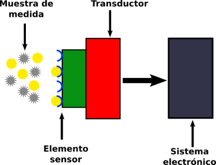

# 2.0 Introducción

### ¿Qué es un sensor? 

Un **sensor** es el elemento de un sistema de medición que responde directamente a una magnitud física, química o biológica —el **mensurando**— y entrega una señal relacionada con ella, normalmente eléctrica. El _Vocabulario Internacional de Metrología_ (VIM) define el sensor como el “elemento de un sistema de medida directamente afectado por un fenómeno, cuerpo o sustancia portador de la magnitud a medir”, y el **mensurando** como la magnitud que se desea medir (<a href="https://www.bipm.org/documents/20126/2071204/JCGM_200_2012.pdf" target="_blank">BIPM, JCGM 200:2012, VIM</a>). En un sistema programable, el sensor es la “puerta de entrada” del mundo físico hacia el microcontrolador: sin él no hay interfaz máquina-máquina posible.

### Transductor y sensor 

Un **transductor** es cualquier dispositivo que convierte una forma de energía o una magnitud en otra con una relación determinada (por ejemplo, temperatura en voltaje, presión en resistencia, voltaje en desplazamiento). Todo sensor es un transductor de entrada, pero no todo transductor es un sensor: un altavoz o un motor son transductores de salida.

| Aspecto                   | Transductor                              | Sensor                                           |
| ------------------------- | ---------------------------------------- | ------------------------------------------------ |
| Definición                | Convierte una magnitud o energía en otra | Elemento directamente afectado por el mensurando |
| Dirección                 | Entrada o salida                         | Siempre de entrada (medición)                    |
| Ejemplos                  | Termopar, altavoz, piezoeléctrico, motor | Termistor NTC, LDR, BME280, HC-SR04              |
| En el sistema programable | Puede ser sensor o actuador              | Alimenta al ADC o a una interfaz digital         |

En la práctica comercial, la palabra “sensor” suele designar un **módulo completo**:

<kbd>elemento sensor</kbd> + <kbd>acondicionamiento</kbd> + <kbd>conversión</kbd> + <kbd>interfaz</kbd>

Por ejemplo, el BME280 integra los elementos sensores de humedad, presión y temperatura, el ADC y las interfaces I²C/SPI en un encapsulado de 2.5 mm × 2.5 mm (<a href="https://www.bosch-sensortec.com/media/boschsensortec/downloads/datasheets/bst-bme280-ds002.pdf" target="_blank">Bosch Sensortec, BME280 Data sheet</a>).

<figure><figcaption>
Imagen 2.2 Sensor BME280 Bosh de humedad, presión y temperatura
</figcaption></figure>

### Cadena de medición 

| Eslabón de la cadena            | Ejemplo para medir temperatura                                   |
| ------------------------------- | ---------------------------------------------------------------- |
| 1. Mensurando                   | Temperatura del aire o de un líquido                             |
| 2. Elemento sensor              | NTC, LM35                                                        |
| 3. Acondicionamiento            | Divisor de voltaje, amplificador operacional, filtro, protección |
| 4. Conversión A/D               | ADC de 10 bits del ATmega328P o ADC integrado en el sensor       |
| 5. Microcontrolador             | ATmega328P de la Arduino Uno                                     |
| 6. Procesamiento y comunicación | Calibración, filtrado, envío por Serial o I²C, pantalla          |

Cada eslabón añade error:

* El sensor tiene tolerancia y deriva;
* El acondicionamiento, ganancia y offset;
* El ADC, cuantización y error de referencia;
* El software, redondeo.

### Clasificación 

| Criterio                      | Clases                                                                                                                    | Ejemplos                                                                                   |
| ----------------------------- | ------------------------------------------------------------------------------------------------------------------------- | ------------------------------------------------------------------------------------------ |
| Energía                       | **Activos** (generan su propia señal, autogeneradores) / **Pasivos** (moduladores, requieren excitación externa)          | Termopar, fotodiodo en modo fotovoltaico, piezoeléctrico / NTC, LDR, galga extensométrica  |
| Tipo de salida                | **Analógica** (voltaje, corriente, resistencia continua) / **Digital** (niveles lógicos, tren de pulsos, protocolo serie) | LM35, MPX5010, GP2Y0A21 / DS18B20, DHT22, BME280, HC-SR04                                  |
| Variable física               | Temperatura, luz, distancia/proximidad, movimiento, presión, humedad, gas, fuerza, campo magnético                        | Revisar los subtemas 2.1, 2.2, 2.3 y 2.4                                                   |
| Principio                     | Resistivo, capacitivo, inductivo, piezoeléctrico, termoeléctrico, fotoeléctrico, efecto Hall, ultrasónico, electroquímico | NTC, humedad capacitiva, proximidad inductiva, termopar, fotodiodo, DRV5053, HC-SR04, MQ-2 |
| Contacto                      | Con contacto / Sin contacto                                                                                               | Termopar en contacto / pirómetro IR, ultrasónico                                           |
| Salida respecto a la variable | Continua (medición) / Binaria (detección, umbral)                                                                         | NTC / PIR HC-SR501, sensor inductivo NPN                                                   |

**Nota**: en la literatura en español, “_**activo**_” se usa a veces con el sentido opuesto (sensor “activo” = el que necesita alimentación). Para el desarrollo de estos apuntes se adopta el criterio energético: **activo = autogenerador**, **pasivo = modulador**, y se pide al estudiante declarar el criterio usado en cada reporte.

### Características estáticas y dinámicas 

#### Características estáticas 

Las características estáticas describen al sensor cuando el mensurando cambia lentamente. Los términos se usan con el sentido del VIM (<a href="https://www.bipm.org/documents/20126/2071204/JCGM_200_2012.pdf" target="_blank">BIPM, JCGM 200:2012</a>).

| Característica             | Definición operativa                                                                   | Ejemplo verificable en hoja de datos                                                                                                                                                   |
| -------------------------- | -------------------------------------------------------------------------------------- | -------------------------------------------------------------------------------------------------------------------------------------------------------------------------------------- |
| Rango (campo de medida)    | Intervalo de valores del mensurando que el sensor mide dentro de especificación        | LM35: −55 °C a 150 °C (<a href="https://www.ti.com/lit/ds/symlink/lm35.pdf" target="_blank">TI, LM35</a>)                                                                              |
| Alcance (span)             | Diferencia entre los extremos del rango                                                | MPX5010: 0 a 10 kPa, span típico 4.5 V (<a href="https://www.mouser.com/datasheet/2/302/MPX5010-3139395.pdf" target="_blank">NXP, MPX5010</a>)                                         |
| Sensibilidad               | Cambio de la salida dividido entre el cambio de la entrada (pendiente)                 | LM35: 10 mV/°C; MPX5010: 450 mV/kPa                                                                                                                                                    |
| Resolución                 | Menor cambio del mensurando que produce un cambio detectable de la salida              | DS18B20: 0.5 °C a 9 bits y 0.0625 °C a 12 bits (<a href="https://www.analog.com/media/en/technical-documentation/data-sheets/DS18B20.pdf" target="_blank">Analog Devices, DS18B20</a>) |
| Exactitud                  | Proximidad entre el valor medido y el valor verdadero; se especifica como error máximo | LM35A: ±0.5 °C a 25 °C (límite probado)                                                                                                                                                |
| Precisión                  | Proximidad entre mediciones repetidas en condiciones especificadas (repetibilidad)     | DHT22: repetibilidad ±0.2 °C (<a href="https://cdn-shop.adafruit.com/datasheets/Digital+humidity+and+temperature+sensor+AM2302.pdf" target="_blank">AM2302/DHT22</a>)                  |
| Linealidad (no linealidad) | Máxima desviación respecto de una recta de referencia                                  | LM35A: no linealidad ±0.18 °C típica                                                                                                                                                   |
| Histéresis                 | Diferencia de salida para la misma entrada según se llegue a ella subiendo o bajando   | BME280: histéresis de humedad ±1 %HR                                                                                                                                                   |
| Offset (cero)              | Salida cuando el mensurando es cero                                                    | MPX5010: 0.2 V típico a 0 kPa                                                                                                                                                          |
| Deriva                     | Cambio de la salida con el tiempo o la temperatura con entrada constante               | DHT22: ±0.5 %HR/año                                                                                                                                                                    |
| Umbral y zona muerta       | Entrada mínima para producir salida / intervalo sin respuesta                          | Sensores de proximidad con histéresis de conmutación (<a href="https://www.ia.omron.com/data_pdf/guide/41/proximity_tg_e_6_2.pdf" target="_blank">Omron, Proximity Sensors</a>)        |

**Exactitud no es precisión.** Un sensor puede ser muy repetible (precisión alta) y estar desplazado 2 °C (exactitud baja): las lecturas se agrupan, pero lejos del valor verdadero. La calibración corrige el sesgo sistemático; no mejora la dispersión aleatoria.

**Resolución del sensor no es resolución del sistema.** Con el ADC de 10 bits del Arduino Uno a 5 V, un LSB vale 5 V / 1024 ≈ 4.9 mV (<a href="https://docs.arduino.cc/language-reference/en/functions/analog-io/analogRead/" target="_blank">Arduino, `analogRead()`</a>). Con un LM35 (10 mV/°C), eso limita la resolución del sistema a ≈ 0.49 °C, aunque el sensor tenga resolución “infinita” por ser analógico. Cambiando la referencia a 1.1 V (apartado 11.2), el LSB baja a ≈ 1.07 mV y la resolución a ≈ 0.11 °C.

#### Características dinámicas 

| Característica                           | Significado                                                                     | Ejemplo                                                                                                                                                                                                 |
| ---------------------------------------- | ------------------------------------------------------------------------------- | ------------------------------------------------------------------------------------------------------------------------------------------------------------------------------------------------------- |
| Tiempo de respuesta                      | Tiempo para alcanzar un porcentaje especificado del valor final ante un escalón | MPX5010: 1.0 ms (10 % a 90 %)                                                                                                                                                                           |
| Constante de tiempo τ                    | En sistemas de primer orden, tiempo para alcanzar el 63.2 % del escalón         | BME280: τ63% = 1 s en humedad                                                                                                                                                                           |
| Tiempo de conversión                     | Tiempo que un sensor digital tarda en entregar un dato nuevo                    | DS18B20: 750 ms a 12 bits, 93.75 ms a 9 bits                                                                                                                                                            |
| Frecuencia máxima de muestreo            | Tasa máxima a la que el sensor o el sistema puede entregar datos útiles         | HC-SR04: se sugiere ciclo de medición mayor a 60 ms (<a href="https://cdn.sparkfun.com/datasheets/Sensors/Proximity/HCSR04.pdf" target="_blank">HC-SR04</a>)                                            |
| Tiempo de calentamiento / estabilización | Tiempo desde el encendido hasta lecturas válidas                                | DHT22: no enviar instrucciones durante 1 s; HC-SR501: cerca de un minuto de inicialización (<a href="https://www.taydaelectronics.com/datasheets/files/A-4432.pdf" target="_blank">Tayda, HC-SR501</a>) |
| Sobreimpulso y amortiguamiento           | Propios de sensores de segundo orden (acelerómetros, galgas en estructuras)     | IMU MPU-6050 con filtro digital configurable                                                                                                                                                            |

Para un sensor de primer orden, la respuesta a un escalón es&#x20;

<figure><figcaption></figcaption></figure>

Tras 5τ la salida está a menos del 1 % del valor final; por eso un termistor sin encapsular responde en segundos y uno dentro de una vaina metálica puede tardar minutos. **Leer el sensor más rápido que su dinámica sólo produce muestras redundantes**, no información nueva.

### Ejemplo numérico integrador 

Un LM35 se lee con el ADC del Arduino Uno a 5 V. El valor verdadero (termómetro de referencia) es 25.0 °C y diez lecturas dan 25.4, 25.9, 25.4, 25.4, 25.9, 25.4, 25.9, 25.4, 25.4 y 25.9 °C.

* Media: 25.6 °C → **error sistemático** ≈ +0.6 °C (exactitud).
* Desviación estándar experimental: ≈ 0.26 °C (precisión).
* Los valores sólo toman dos niveles separados 0.49 °C: es la **cuantización** del ADC (1 LSB), no ruido del sensor.
* Conclusión: el sistema está limitado por la resolución del ADC; conviene usar la referencia interna de 1.1 V y promediar, y después corregir el offset por calibración.

<figure><figcaption>
Imagen 2.3 Uso de sensores en el hogar (<a href="https://ayudadomotica.com/guia/modulo-3/sensores-domoticos-movimiento-puertas-temperatura/">https://ayudadomotica.com/guia/modulo-3/sensores-domoticos-movimiento-puertas-temperatura/</a>)
</figcaption></figure>

