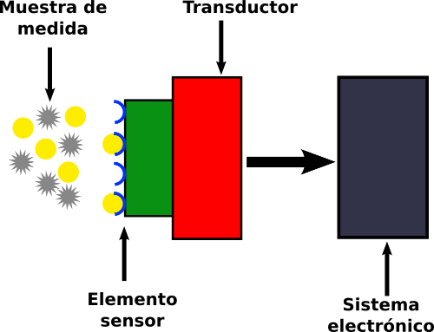

# 2.1 Ópticos

### 2.1.0 Fundamentos de sensores

#### ¿Qué es un sensor? 

Un **sensor** es el elemento de un sistema de medición que responde directamente a una magnitud física, química o biológica —el **mensurando**— y entrega una señal relacionada con ella, normalmente eléctrica. El _Vocabulario Internacional de Metrología_ (VIM) define el sensor como el “elemento de un sistema de medida directamente afectado por un fenómeno, cuerpo o sustancia portador de la magnitud a medir”, y el **mensurando** como la magnitud que se desea medir (<a href="https://www.bipm.org/documents/20126/2071204/JCGM_200_2012.pdf" target="_blank">BIPM, JCGM 200:2012, VIM</a>). En un sistema programable, el sensor es la “puerta de entrada” del mundo físico hacia el microcontrolador: sin él no hay interfaz máquina-máquina posible.

#### Transductor y sensor 

Un **transductor** es cualquier dispositivo que convierte una forma de energía o una magnitud en otra con una relación determinada (por ejemplo, temperatura en voltaje, presión en resistencia, voltaje en desplazamiento). Todo sensor es un transductor de entrada, pero no todo transductor es un sensor: un altavoz o un motor son transductores de salida.

| Aspecto                   | Transductor                              | Sensor                                           |
| ------------------------- | ---------------------------------------- | ------------------------------------------------ |
| Definición                | Convierte una magnitud o energía en otra | Elemento directamente afectado por el mensurando |
| Dirección                 | Entrada o salida                         | Siempre de entrada (medición)                    |
| Ejemplos                  | Termopar, altavoz, piezoeléctrico, motor | Termistor NTC, LDR, BME280, HC-SR04              |
| En el sistema programable | Puede ser sensor o actuador              | Alimenta al ADC o a una interfaz digital         |

En la práctica comercial, la palabra “sensor” suele designar un **módulo completo**:

&#x20;<kbd>elemento sensor</kbd> + <kbd>acondicionamiento</kbd> + <kbd>conversión</kbd> + <kbd>interfaz</kbd>

Por ejemplo, el BME280 integra los elementos sensores de humedad, presión y temperatura, el ADC y las interfaces I²C/SPI en un encapsulado de 2.5 mm × 2.5 mm (<a href="https://www.bosch-sensortec.com/media/boschsensortec/downloads/datasheets/bst-bme280-ds002.pdf" target="_blank">Bosch Sensortec, BME280 Data sheet</a>).

<figure><figcaption>
Imagen 2.2 Sensor BME280 Bosh de humedad, presión y temperatura
</figcaption></figure>

#### Cadena de medición 

| Eslabón de la cadena            | Ejemplo para medir temperatura                                   |
| ------------------------------- | ---------------------------------------------------------------- |
| 1. Mensurando                   | Temperatura del aire o de un líquido                             |
| 2. Elemento sensor              | NTC, LM35                                                        |
| 3. Acondicionamiento            | Divisor de voltaje, amplificador operacional, filtro, protección |
| 4. Conversión A/D               | ADC de 10 bits del ATmega328P o ADC integrado en el sensor       |
| 5. Microcontrolador             | ATmega328P de la Arduino Uno                                     |
| 6. Procesamiento y comunicación | Calibración, filtrado, envío por Serial o I²C, pantalla          |

Cada eslabón añade error:&#x20;

* El sensor tiene tolerancia y deriva;&#x20;
* El acondicionamiento, ganancia y offset;&#x20;
* El ADC, cuantización y error de referencia;&#x20;
* El software, redondeo.

#### Clasificación 

| Criterio                      | Clases                                                                                                                    | Ejemplos                                                                                   |
| ----------------------------- | ------------------------------------------------------------------------------------------------------------------------- | ------------------------------------------------------------------------------------------ |
| Energía                       | **Activos** (generan su propia señal, autogeneradores) / **Pasivos** (moduladores, requieren excitación externa)          | Termopar, fotodiodo en modo fotovoltaico, piezoeléctrico / NTC, LDR, galga extensométrica  |
| Tipo de salida                | **Analógica** (voltaje, corriente, resistencia continua) / **Digital** (niveles lógicos, tren de pulsos, protocolo serie) | LM35, MPX5010, GP2Y0A21 / DS18B20, DHT22, BME280, HC-SR04                                  |
| Variable física               | Temperatura, luz, distancia/proximidad, movimiento, presión, humedad, gas, fuerza, campo magnético                        | Revisar los subtemas 2.1, 2.2, 2.3 y 2.4                                                   |
| Principio                     | Resistivo, capacitivo, inductivo, piezoeléctrico, termoeléctrico, fotoeléctrico, efecto Hall, ultrasónico, electroquímico | NTC, humedad capacitiva, proximidad inductiva, termopar, fotodiodo, DRV5053, HC-SR04, MQ-2 |
| Contacto                      | Con contacto / Sin contacto                                                                                               | Termopar en contacto / pirómetro IR, ultrasónico                                           |
| Salida respecto a la variable | Continua (medición) / Binaria (detección, umbral)                                                                         | NTC / PIR HC-SR501, sensor inductivo NPN                                                   |

**Nota**: en la literatura en español, “_**activo**_” se usa a veces con el sentido opuesto (sensor “activo” = el que necesita alimentación). Para el desarrollo de estos apuntes se adopta el criterio energético: **activo = autogenerador**, **pasivo = modulador**, y se pide al estudiante declarar el criterio usado en cada reporte.

### 2.1.1 Tipos

### 2.1.2 Funcionamiento

### 2.1.3 Características

### 2.1.4 Modo de comunicación
